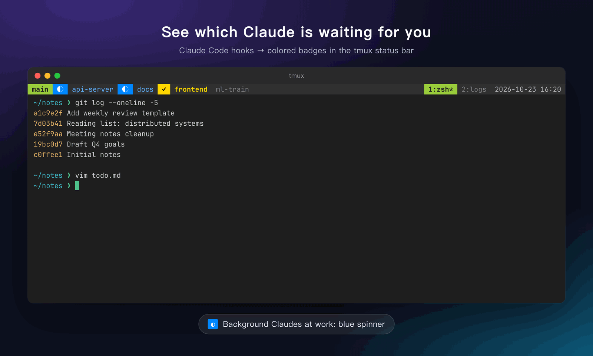
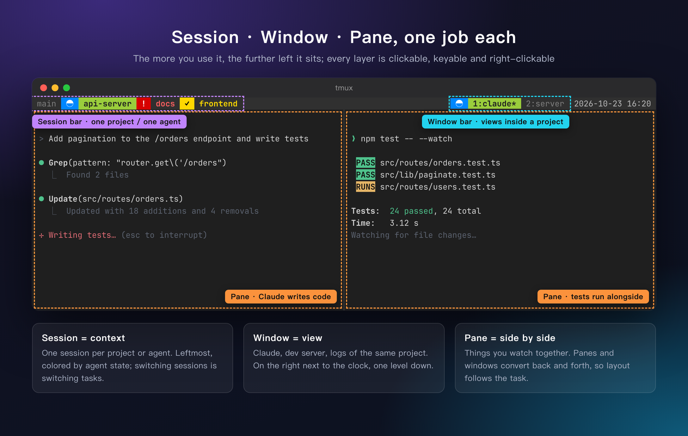
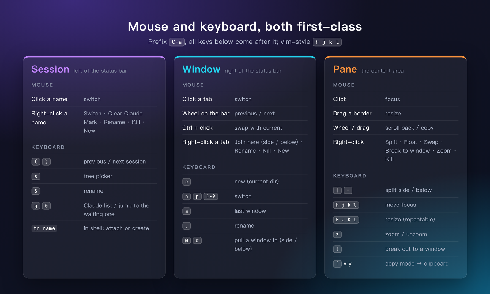
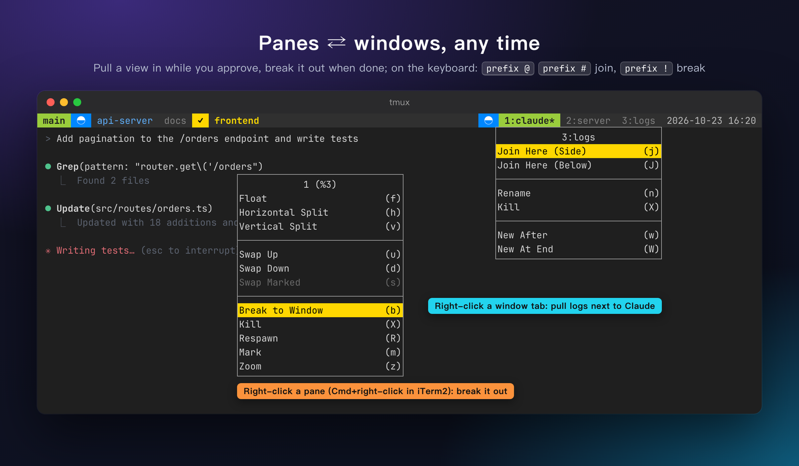
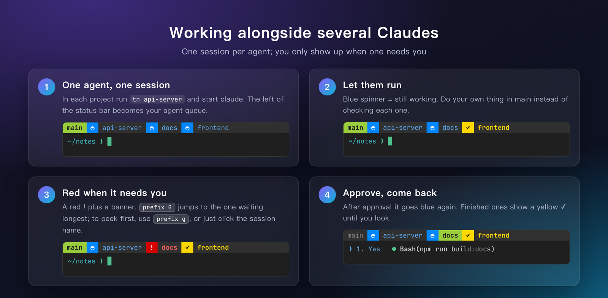
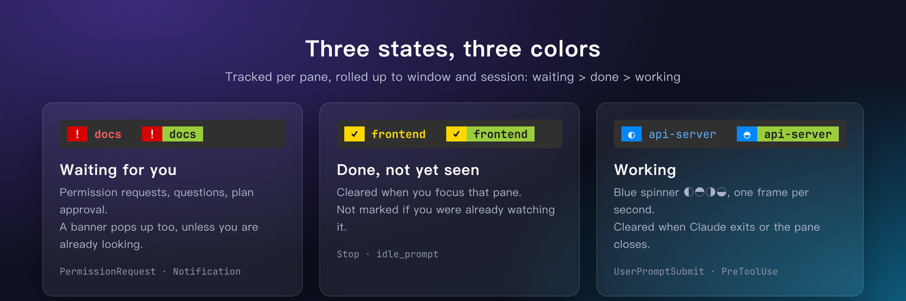
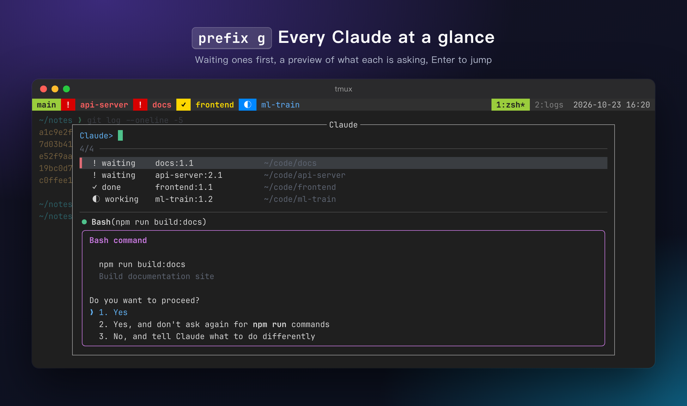
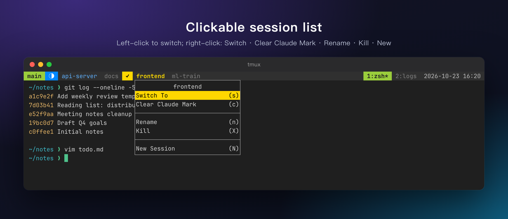

# tmux-claude-iterm2-setup

**English** | [中文](README.zh-CN.md)

A macOS terminal setup (zsh + vim + tmux + iTerm2) built around two ideas:

1. **[Session · Window · Pane, one job each](#1-session--window--pane-one-job-each)**: a clear hierarchy that works equally well with the mouse and the keyboard.
2. **[Working alongside several AI agents](#2-working-alongside-several-claudes)**: one session per agent, with Claude Code's state shown as colored badges in the tmux status bar.



## 1. Session · Window · Pane, one job each



| Layer | What it holds | Where it lives |
|---|---|---|
| **Session** | One project or one agent. Switching sessions means switching tasks. | Leftmost on the status bar, the most visible spot, colored by agent state |
| **Window** | Different views of the same project: Claude, dev server, logs | Right side of the bar, next to the clock |
| **Pane** | Things you want to see together: Claude + tests, Claude + diff | The content area |

The rules behind it:

- **The more you use it, the further left it sits.** You switch sessions most often, so they get the left edge, and they are always visible.
- **Every layer works the same way**: left-click to select, right-click for a menu, and a key after the `C-a` prefix. Mouse and keyboard are equally capable.
- **Layout follows the task.** A pane can become a window and a window can become a pane at any time, so you don't have to plan the layout up front.

### Mouse and keyboard



Prefix is `C-a`. Movement uses vim's `h j k l`. Splits open in the current directory.

### Panes ⇄ windows



- Right-click a **window tab** → *Join Here (Side / Below)* pulls that window into the current one as a pane. Keyboard: `prefix @` / `prefix #` opens a picker.
- Right-click a **pane** → *Break to Window* turns it back into its own window. Keyboard: `prefix !`.
- The pane menu is tmux 3.8's default menu (split, float, swap, zoom…) plus *Break to Window*. It always opens, even when the program in the pane (such as Claude Code) captures the mouse. In iTerm2, Cmd+right-click works too.

## 2. Working alongside several Claudes



1. **One agent, one session.** In each project, `tn api-server` attaches to or creates a session, then start `claude` there. The left of the status bar becomes your agent queue.
2. **Let them run.** A blue spinner means it's still working. Stay in your own session instead of checking each one.
3. **Red when it needs you.** A red `!` plus a one-line banner. `prefix G` jumps to the one that has been waiting longest. `prefix g` lists every Claude with a preview of what it's asking. You can also click the session name.
4. **Approve, come back.** It turns blue again. Finished ones show a yellow `✓` until you look at them.

Inside a session, combine this with part 1. Keep Claude in window 1 and the server or logs in window 2. When you need to watch logs while approving, join that window next to Claude with `prefix @`, and break it back out with `prefix !` when you're done. Two Claudes in panes of the same window keep separate states.

### How the badges work

Claude Code hooks write each pane's state into tmux options. The status bar renders them:



| Badge | Meaning |
|---|---|
| red `!` | Waiting for you (permission request / question). A banner also shows on the status line, unless you're already looking at that pane. |
| yellow `✓` | Finished and you haven't looked yet. Cleared when you focus that pane. |
| blue `◐◓◑◒` | Working. The spinner advances once per second. |

- State is tracked per pane. It is rolled up to windows and sessions with the priority waiting > done > working, so nothing gets overwritten.
- Stale badges are cleaned up when a pane exits or is killed. The cleanup checks whether a `claude` process is still running in the pane.
- `prefix g` shows every Claude, waiting ones first, with a live preview. Press Enter to jump to one:

  

- Right-click a session name for *Switch / Clear Claude Mark / Rename / Kill / New*:

  

- Coexists with iTerm2's built-in Claude Code integration hooks.

> In-terminal text (picker labels, the banner) is Chinese by default. Switch it to English in `~/.tmux.conf`:
>
> ```tmux
> set -g @cc_lang en
> ```

## Also included

- **tmux**: vi copy mode (copies to the macOS clipboard). Sessions are restored with resurrect + continuum. zsh auto-attaches to a `main` session. Requires tmux ≥ 3.8.
- **zsh**: no framework. Uses eza / bat / fzf / zoxide / starship / autosuggestions / syntax-highlighting, plus small fzf helpers `f`, `fv`, `rgi`, `cproj`.
- **vim**: vim-plug with NERDTree, fugitive, lightline, and more.
- **iTerm2**: "Moshi Dark" dynamic profile (JetBrains Mono + Noto Sans Mono CJK) and the Minimal theme.

## Install

```bash
git clone https://github.com/lihengchaocn-png/tmux-claude-iterm2-setup.git
cd tmux-claude-iterm2-setup
bash scripts/install.sh shell    # zsh + Homebrew CLI tools + uv (overwrites ~/.zshrc)
bash scripts/install.sh vim
bash scripts/install.sh tmux
bash scripts/install.sh claude   # Claude Code hook (needs jq), merged idempotently into ~/.claude/settings.json
bash scripts/install.sh iterm    # run from Terminal.app while iTerm2 is not running
bash scripts/install.sh all      # everything above
```

Overwritten files are backed up as `*.bak-<timestamp>`. `zprofile` points Homebrew at the Tsinghua (TUNA) mirror in China. Delete those lines if you don't need it.

The showcase images are rendered from `docs/src/scene.html` with demo data. English and Chinese sets are under `docs/img/`. Regenerate them with `bash docs/src/render.sh` after changing colors.

`SKILL.md` is a Claude Code skill: put this directory at `~/.claude/skills/terminal-setup/` and Claude will pick it up. It documents the implementation in more detail.

## License

[MIT](LICENSE)
