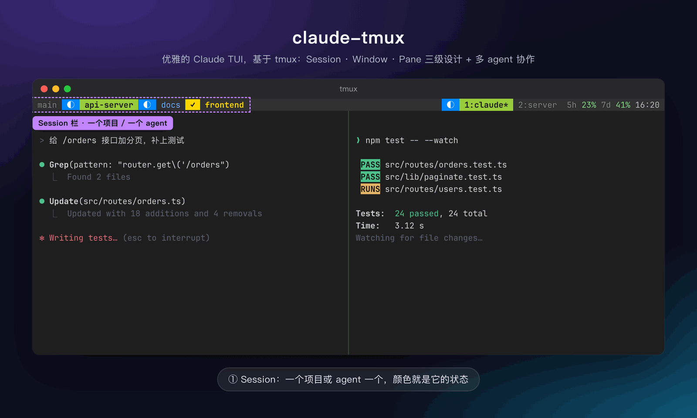
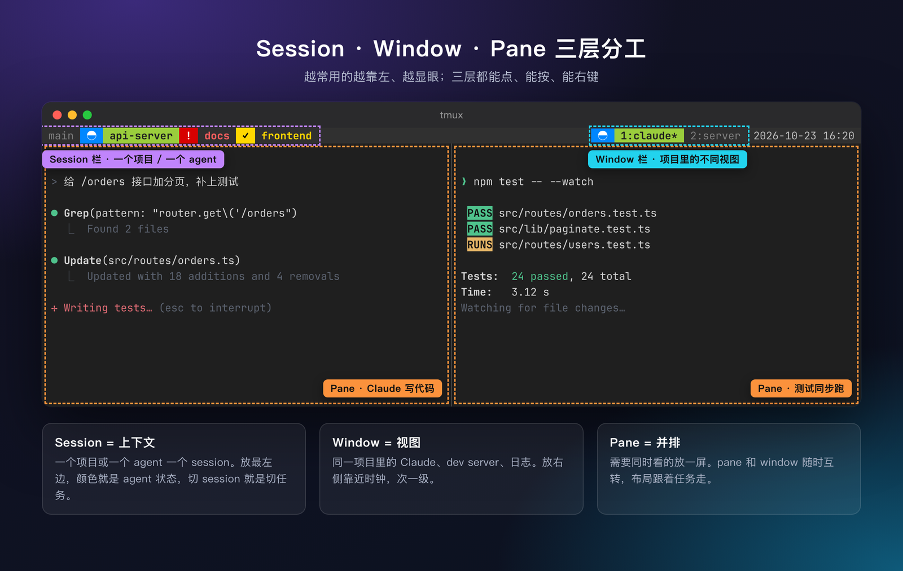
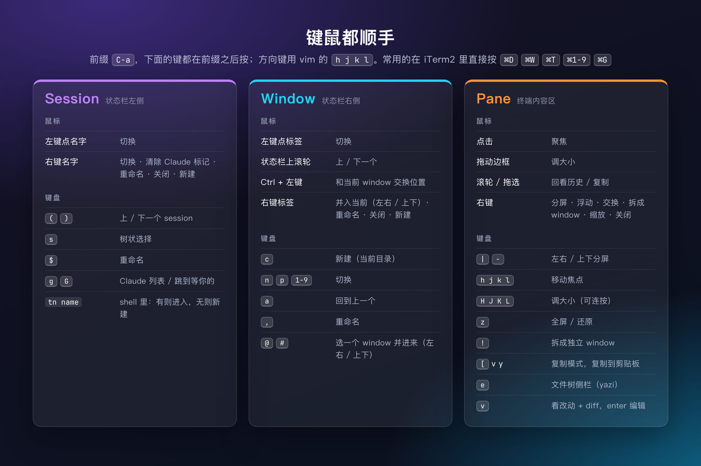
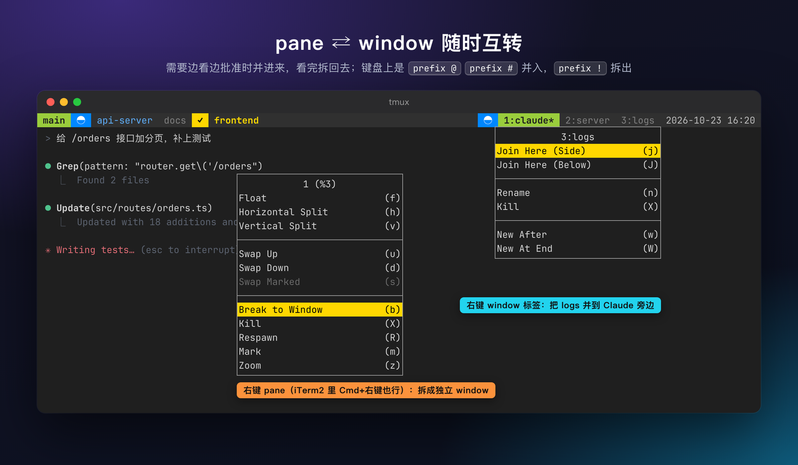
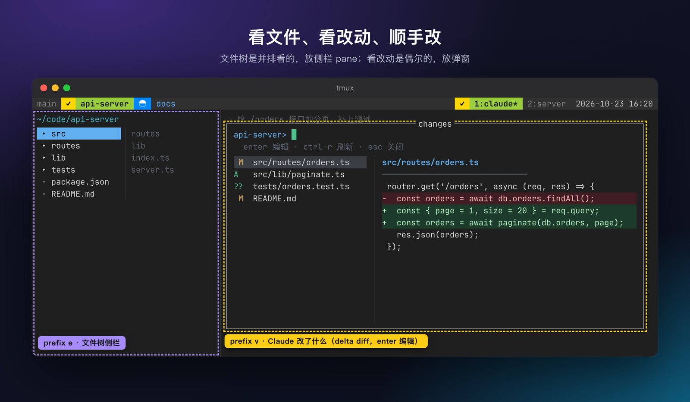
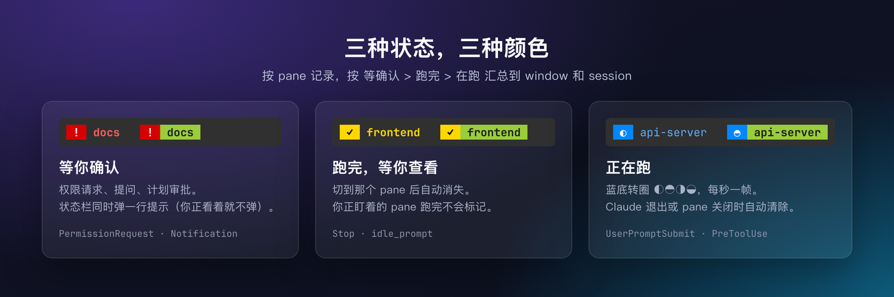
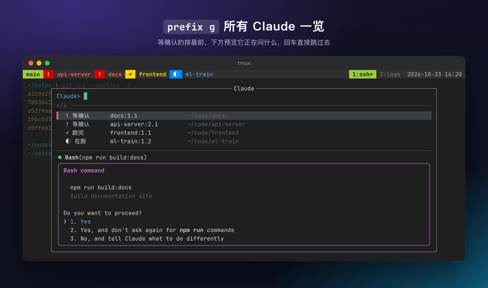
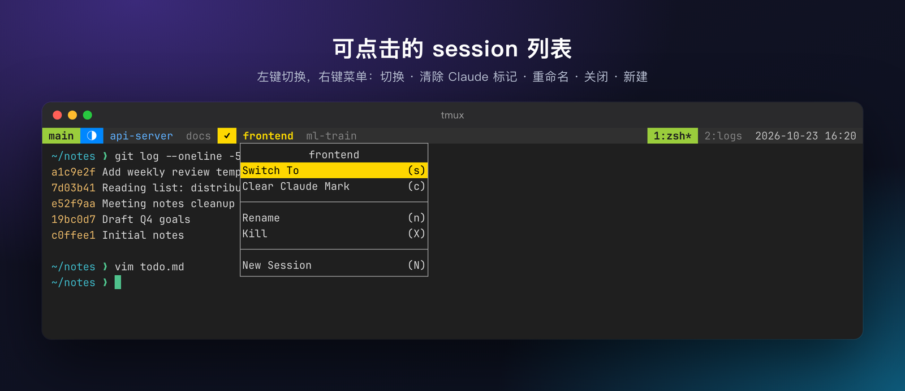
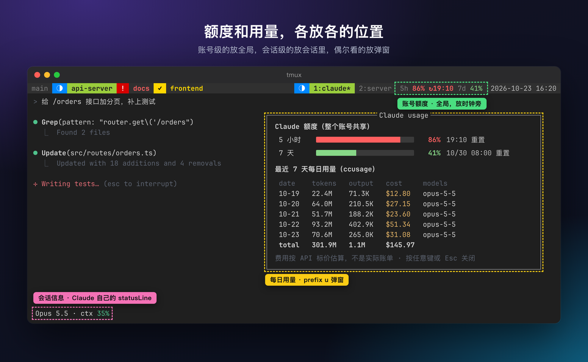

# claude-tmux

[English](README.md) | **中文**

**优雅的 Claude TUI，基于 tmux。** Session · Window · Pane 三级设计，专为同时和多个 Claude Code agent 协作而做；另附一套 macOS 终端配置（zsh、vim、iTerm2）。

两个核心想法：

1. **[Session · Window · Pane 三层分工](#1-session--window--pane-三层分工)**：层次清楚，鼠标和键盘都一样顺手。
2. **[和多个 AI agent 一起干活](#2-和多个-claude-一起干活)**：一个 agent 一个 session，Claude Code 的状态直接显示在 tmux 状态栏上，还能看到剩余额度和每日用量。



## 1. Session · Window · Pane 三层分工



| 层 | 放什么 | 在哪 |
|---|---|---|
| **Session** | 一个项目或一个 agent，切 session 就是切任务 | 状态栏最左边，最显眼，颜色就是 agent 状态 |
| **Window** | 同一项目里的不同视图：Claude、dev server、日志 | 状态栏右侧，挨着时钟 |
| **Pane** | 需要同时看的东西：Claude + 测试、Claude + diff | 内容区 |

背后的几条原则：

- **越常用越靠左、越显眼。** 切 session 最频繁，所以放在最左边，一直可见。
- **三层的操作方式一样**：左键选中，右键出菜单，键盘上是 `C-a` 前缀后跟一个键。鼠标和键盘能做的事一样多。
- **布局跟着任务走。** pane 随时能拆成 window，window 也能随时并回来当 pane，不用一开始就把布局想好。

### 键鼠操作



前缀是 `C-a`。移动焦点用 vim 的 `h j k l`。分屏会继承当前目录。

**iTerm2 里免按前缀。** 最常用的操作在 Moshi Dark profile 里映射成了 Cmd 键，由 iTerm2 替你发 `C-a` + 键。Cmd 键不会传给终端里的程序，所以不会和 shell、vim、Claude Code 抢键。

| 按键 | 作用 | 等价于 |
|---|---|---|
| `Cmd+D` / `Cmd+Shift+D` | 左右 / 上下分屏 | `C-a \|` / `C-a -` |
| `Cmd+W` | 关闭 pane：空闲 shell 直接关；有程序在跑（claude、vim、ssh…）时再按一次 `x` 确认，按别的键取消 | `C-a x` |
| `Cmd+T` | 新 window | `C-a c` |
| `Cmd+1…9` | 切到第 N 个 window | `C-a 1…9` |
| `Cmd+Option+←↓↑→` | 切换 pane | `C-a h/j/k/l` |
| `Cmd+Shift+Enter` | 放大 / 还原 pane | `C-a z` |
| `Cmd+G` / `Cmd+Shift+G` | Claude 列表 / 跳到最早等你的 | `C-a g` / `C-a G` |

低频操作继续用前缀。`Cmd+G` 占用了 iTerm2 的“查找下一个”，搜索改用 tmux 的复制模式。

### pane ⇄ window 互转



- 右键 **window 标签** → *Join Here (Side / Below)*，把那个 window 作为 pane 并到当前 window。键盘上是 `prefix @` / `prefix #`，会弹出选择器。
- 右键 **pane** → *Break to Window*，把它拆回独立 window。键盘上是 `prefix !`。
- pane 菜单是 tmux 3.8 的默认菜单（分屏、浮动、交换、缩放……）加上 *Break to Window*。即使 pane 里的程序（比如 Claude Code）接管了鼠标，菜单也照样弹出。iTerm2 里 Cmd+右键也可以。

## 2. 和多个 Claude 一起干活


1. **一个 agent 一个 session。** 在每个项目目录里用 `tn api-server` 进入或新建 session，然后在里面跑 `claude`。状态栏左边就成了你的 agent 队列。
2. **后台跑，不用盯。** 蓝色转圈表示还在干活。你待在自己的 session 里，不用挨个切过去看。
3. **需要你时冒红。** 红底 `!`，状态栏同时弹一行提示。`prefix G` 直接跳到最早开始等你的那个；`prefix g` 列出所有 Claude，可以先预览它在问什么；也可以直接点 session 名。
4. **批准，再回来。** 批准后标记变回蓝色。跑完的显示黄色 `✓`，你看过之后自动消失。

在 session 内部，可以和第一部分配合着用。window 1 放 Claude，window 2 放 server 或日志。需要一边看日志一边批准时，用 `prefix @` 把日志 window 并到 Claude 旁边，看完再用 `prefix !` 拆回去。同一个 window 里两个 pane 各跑一个 Claude，状态也会分开记录。

### 看文件、看改动、顺手改



- **`prefix v`：Claude 刚才改了什么。** 弹窗列出当前 pane 所在 git 仓库里有改动的文件和未跟踪的文件，右侧用 [delta](https://github.com/dandavison/delta) 显示 diff。回车用 `$EDITOR` 打开，`ctrl-r` 刷新，Esc 关闭。偶尔才看，所以和 `prefix g`、`prefix u` 一样做成弹窗。
- **`prefix e`：文件树侧栏。** 在当前 pane 左侧开关一个约 30% 宽的 [yazi](https://github.com/sxyazi/yazi)，目录跟随当前 pane。它要和 Claude 并排看，所以做成 pane，也能用 `prefix !` 拆成独立 window。侧栏太窄不适合编辑，文本文件会在弹窗里用 `$EDITOR` 打开。
- Claude Code 能发现文件在它读过之后被改过，不会互相覆盖；但最好不要在它正在改某个文件时去改同一个文件。

### 徽标是怎么工作的

Claude Code 的 hook 把每个 pane 的状态写进 tmux 选项，状态栏据此显示：



| 徽标 | 含义 |
|---|---|
| 红底 `!` | 等你确认（权限请求 / 提问）。状态栏同时弹一行提示，你正看着那个 pane 时不弹 |
| 黄底 `✓` | 跑完了，你还没看。切到那个 pane 后自动消失 |
| 蓝底 `◐◓◑◒` | 正在跑，每秒转一帧 |

- 状态按 pane 记录，再按 等确认 > 跑完 > 在跑 的优先级汇总到 window 和 session，不会互相覆盖。
- pane 退出或被 kill 时会清理残留的标记。判断方法是看 pane 里还有没有 `claude` 进程。
- `prefix g` 列出所有 Claude，等确认的排最前，带实时预览，回车跳过去：

  

- 右键 session 名有 *Switch / Clear Claude Mark / Rename / Kill / New* 菜单：

  

- 与 iTerm2 自带的 Claude Code 集成 hook 共存。
- 终端里的提示文字（跳转列表、提示条）默认是中文。在 `~/.tmux.conf` 里加 `set -g @cc_lang en` 可以切成英文。

### 额度和每日用量



不同的数字放在各自该在的位置：

| 显示什么 | 放在哪 | 数据来源 |
|---|---|---|
| 5 小时 / 7 天额度用了多少 | tmux 状态栏右侧，挨着时钟。低于 50% 绿色，低于 80% 黄色，80% 及以上红色并显示重置时间 | Claude Code 传给 statusLine 的 `rate_limits`，由 `cc-statusline.sh` 写进 tmux。Claude 还没回复过时，先用 `~/.claude.json` 里的缓存 |
| 上下文占用、模型 | Claude 自己的 statusLine | statusLine 输入 |
| 最近 7 天每日 token 和费用 | `prefix u` 弹窗（用 less 翻页，`q` 关闭） | [ccusage](https://github.com/ryoppippi/ccusage)，通过 `bunx` / `npx` 运行 |

- 额度是整个账号共享的，不属于任何一个 session，所以放在时钟旁边。每日用量只是偶尔看一眼，所以放进弹窗，不占状态栏。
- ccusage 的费用是按 API 标价估算的。订阅用户的实际账单不是这个数，只能用来比较哪天用得多。
- 只有 Pro / Max 订阅用户才有 `rate_limits` 数据。
- `install.sh claude` 只在你还没有 statusLine 时才设置；如果已经有了，会打印提示，你可以在自己的脚本里调用 `cc-statusline.sh`。

## 其他

- **tmux**：vi 复制模式（复制到 macOS 剪贴板）；用 resurrect + continuum 自动恢复会话；zsh 启动时自动进入 `main` 会话。需要 tmux ≥ 3.8。
- **zsh**：不用框架；装了 eza / bat / fzf / zoxide / starship / autosuggestions / syntax-highlighting，另有 `f` `fv` `rgi` `cproj` 几个 fzf 小工具。
- **vim**：vim-plug + NERDTree、fugitive、lightline 等。
- **iTerm2**：Moshi Dark 动态 profile（JetBrains Mono + Noto Sans Mono CJK），Minimal 主题。yazi 的文件图标来自 Symbols Nerd Font，macOS 会自动回退到这个字体，不用换终端字体。

## 安装

```bash
git clone https://github.com/lihengchaocn-png/claude-tmux.git
cd claude-tmux
bash scripts/install.sh shell    # zsh + Homebrew CLI 工具 + uv（会覆盖 ~/.zshrc）
bash scripts/install.sh vim
bash scripts/install.sh tmux
bash scripts/install.sh claude   # Claude Code hook + statusLine（依赖 jq），幂等合并进 ~/.claude/settings.json
bash scripts/install.sh iterm    # 需在 iTerm2 退出状态下、从 Terminal.app 运行
bash scripts/install.sh all      # 以上全部
```

被覆盖的文件会先备份为 `*.bak-<时间戳>`。`zprofile` 里配置的是清华 Homebrew 镜像，海外用户可以删掉那几行。

展示图是用 `docs/src/scene.html` 仿真渲染的，内容是演示数据，`docs/img/` 下中英文各一套。改了配色后可以用 `bash docs/src/render.sh` 重新生成。

`SKILL.md` 是给 Claude Code 用的 skill 说明：把本目录放在 `~/.claude/skills/terminal-setup/` 下，Claude 就能识别。里面有更详细的实现细节。

## License

[MIT](LICENSE)
